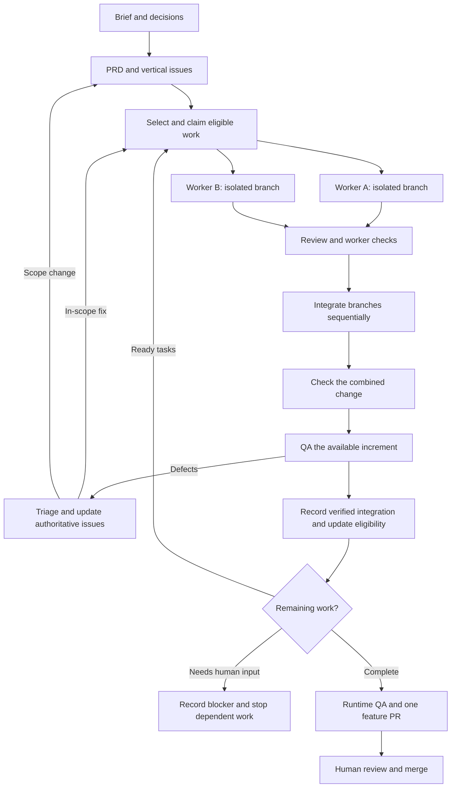

# Architecture work, runtimes and parallel execution

This is the operating design and rollout plan. It does not activate an automatic scheduler, Docker runtime or Sandcastle integration.

## When each capability runs

| Capability | Trigger | Outcome |
|---|---|---|
| Architecture assessment | Requested review, repeated change friction, or a real feature blocked by poor boundaries | Evidence-backed candidates; selected work enters the normal planning flow |
| Documentation correction | A source of truth is missing or contradicts actual behavior | A scoped docs fix and relevant link/config checks |
| Research/prototype | A named uncertainty prevents a decision | Findings or an experiment verdict |
| One-task execution | A selected task is ready, AFK and unblocked | Changes plus verification evidence |
| Sequential loop | Bounded execution is authorized and scheduling/recovery is implemented | Ready tasks executed one at a time |
| Parallel execution | Several genuinely independent ready tasks exist and isolation/integration controls are implemented | Separate worker branches, reviewed and integrated |
| Runtime QA | The integrated candidate is ready to exercise | Evidence of actual behavior; remaining human checks explicit |

Architecture assessment is an optional entry route, not a gate before every task. Docker and Sandcastle are execution choices beneath the same workflow.

## Work lifecycle

Parallel workers operate on separate working trees. A branch name alone does not isolate files. Integration is sequential even when implementation is parallel.

A worker report, completion marker, exit code or commit count is not a sufficient acceptance check. Preserve failed work and report the failure; do not let a retry replay already-completed external actions.

## Who does what

- Planner: resolve scope and decisions, produce the PRD and task graph. HITL where judgment is required.
- Batch planner: propose independent issues/phases when choosing work needs code or interface judgment. Review true blockers and likely shared-file conflicts; nondependent issue ids alone do not prove safe parallelism.
- Scheduler: validate proposals against authoritative status, dependencies, claims and concurrency limits before dispatch. Prefer deterministic checks over another LLM call for routine selection. Re-read eligibility before each batch; a new QA blocker can invalidate an earlier plan.
- Implementer: one selected task, focused context, meaningful tests and a portable result.
- Reviewer: compare the diff with project standards and the task/spec; escalate unresolved product decisions.
- Integrator: merge reviewed branches into a feature integration branch and verify their combination. Use an agent for genuine conflict resolution when needed.
- Human: complete required judgment/QA and own final approval/merge according to project policy.

## Continuous QA and review context

QA can inspect a stable integrated increment while workers build other increments. It records the tested revision/environment and returns reproducible findings to the authoritative backlog using the [QA procedure](../skills/qa/SKILL.md). Triage new work before scheduling it; preserve active claims and completed evidence, and stop only affected dependent work when a blocker is found. Final acceptance still checks the combined feature. Shared devices remain sequential.

Prepare implementation context around the selected issue and required project rules, with additional docs pulled as needed. Prepare review context with explicit applicable coding standards, requirement references, the bounded diff and verification evidence. Neither stage needs the whole instruction library. See [review](../skills/review/SKILL.md) and [model policy](../references/model-policy.md) for role-specific context and capacity choices.

These procedures can be followed by a supervised agent now. Automatic QA issue ingestion, batch revalidation and role-specific prompt assembly remain runner work.

## Integration, acceptance and issue closure

Branches merge; issue records change status. Integrating a worker branch into a feature branch is distinct from merging the final PR into main.

The current task contract uses review while required checks or human review remain pending; done requires its agreed acceptance/review conditions. GitHub issues intended to close through a PR should close when that PR is merged, not when an implementer exits.

The current helper only treats blockers marked done as satisfied. A future scheduler must record verified integration separately from final human acceptance if it should unlock downstream work before the final feature review. Implement and test that distinction before enabling the loop; never mark human review complete just to unblock a task.

## Sandcastle's role

Sandcastle is a TypeScript orchestration library, not the complete product-planning or issue-acceptance policy. The inspected revision exports Claude Code and Codex providers, multiple sandbox providers, explicit worktree/branch strategies, reusable sandboxes, hooks and run results.

Its Docker provider uses containers with bind mounts. Docker Sandboxes is a separate microVM-based product used by the workshop shell scripts. Do not assume their CLI, credentials or isolation boundaries are interchangeable.

Choose explicit worker branches/worktrees. The inspected Docker bind-mount path defaults to head, which writes into the host working tree; it is unsuitable as an implicit default for parallel workers. The library also offers automatic merge strategies, so our adapter must choose a strategy consistent with the project's human-owned delivery policy.

If adopted, keep the optional dependency under a shared backend such as runners/sandcastle, with its own package/lockfile. Pass project paths, prompts, task ids, agent selection and runtime settings through a defined adapter. Do not add the orchestration library to every application's dependencies.

## Controls needed before unattended runs

- An authoritative task graph and atomic claims.
- Bounded run count, retry count, elapsed time and initial concurrency.
- Provisioned tools, dependencies and a readable shared kit in every worker.
- Defined credential, network, filesystem and shared-device access.
- Structured portable results and actual verification.
- A lock around integration and protection against a branch moving during a run.
- Recovery of partial edits/commits and logs, with clear failed/blocked state.
- Explicit ownership of commits, pushes, tracker writes and final merges.

These are requirements for the future runner, not capabilities implied by the present configuration.

## Rollout in a project

1. Pilot the existing procedures on a real feature using supervised one-task execution.
2. Add task-state/integration tracking, claims and bounded sequential execution.
3. Validate one isolated worker with the project's runtime versions, dependencies and actual required checks.
4. Evaluate a Sandcastle backend against the same task/result contract. Start with at most two independent workers when it earns a latency benefit.
5. Integrate and verify on one feature branch, then follow the project's PR and human approval conventions.
6. For mobile projects, keep shared-device installs and UI QA sequential. Preserve project-specific concurrency restrictions. Containers do not create independent devices. Respect an emulator the user is using.

Helper work and isolated tests may parallelize when resources and dependency boundaries permit. Do not run competing development-server/device sessions against shared resources. Full combined verification and applicable device/audio review still happen at the feature level.

Parallelism can reduce elapsed time while increasing token/context overhead. Measure accepted outcomes, rework, human review effort, latency and usage before expanding concurrency.

## Sources

- [Sandcastle snapshot](https://github.com/mattpocock/sandcastle/tree/79664a78bd2df636bf14069e5452c0d3659be8af), checked 2026-11-01.
- [Matt's architecture skill](https://github.com/mattpocock/skills/blob/4ae2317ddb22b046e26455e4f9c9b3aaaf62212d/skills/engineering/improve-codebase-architecture/SKILL.md).
- [Workshop comparison](research/workshop-comparison.md) and [earlier source audit](research/matt-pocock-audit.md).
