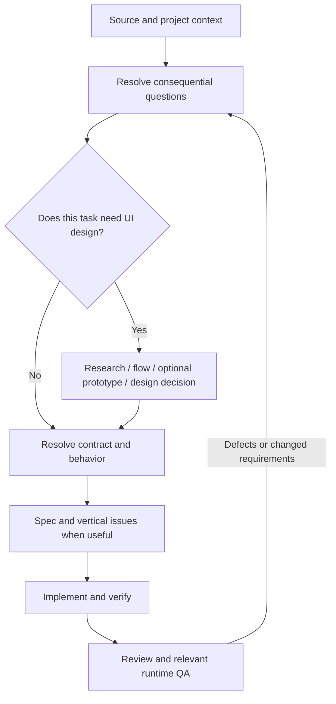

# One workflow, different work

The core stays the same: intake and clarification, optional research/prototype, specification and bounded tasks when needed, implementation, review and QA. Choose extra procedures by the current task's uncertainty, not just the repository's label. A full-stack repository may contain a backend-only bug or a UI-only adjustment.

## Routes

| Work | Useful planning focus | Verification emphasis |
|---|---|---|
| UI research/design only | Audience/task, evidence, flow/state options, selected direction | Prototype observations, unresolved decisions and usable implementation handoff; no claim that production is implemented |
| Frontend | Optional `ui-design`, existing components/tokens, real or explicitly mocked data contract | User interactions, relevant states, layout, accessibility and actual data behavior |
| Full stack | UI flow plus service/data contract, failure behavior and migration/rollout where relevant | Thin end-to-end slices, contract/integration checks and runtime UI QA |
| Backend/API/service | Consumer-visible contract, invariants, failures, authorization and data/concurrency behavior as relevant | Public-boundary tests, integration/contract checks and applicable operational evidence; skip UI design |
| Small clear fix | Existing issue and focused diagnosis | Reproduction and proportionate regression/review checks; no mandatory PRD or design record |

These are planning prompts, not a requirement to perform every listed activity on every task.

## UI and frontend

Use the UI procedure when interaction, hierarchy, visual direction or usability is uncertain. It composes `research`, `grill`, `prototype` and existing delivery procedures. It is not a second independent pipeline or an instruction to redesign every screen.

A design record may live at docs/work/<feature>/design.md beside existing work records; use the project's location instead when different. Keep product/audience rules, branding and framework-specific details in the project. Research notes, screenshots and prototypes are optional evidence, not folders to create up front. Product decisions go into the PRD/task so the implementation does not depend on chat history.

For frontend-only work, verify states with the agreed data contract. Label fixtures/mocks so a successful mock does not imply a real backend integration. For full-stack work, connect the same user outcome through the necessary layers. Temporary fixtures must not silently become the production behavior.

[W3C's WCAG quick reference](https://www.w3.org/WAI/WCAG22/quickref/) is a primary reference for applicable web accessibility criteria and techniques. Native work should consult its platform's guidance. Record the chosen project target and actual checks; a visual mockup or passing automated scan is not a conformance assessment. Consult current sources when a specific requirement matters.

## Backend and full stack

Use the existing architecture, research, prototype, specification, implementation and review procedures. A prototype can test a migration, performance assumption or service interaction without any UI. Define the caller's contract and expected errors before implementing; specify schemas, authorization, retries/idempotency, compatibility, observability or rollout only where this task requires them.

A vertical slice needs an observable outcome, not necessarily a screen. For example, one endpoint can validate a request, persist the intended change and return the agreed response with meaningful integration tests. Public service behavior can be a complete slice in a backend project.

For a multi-layer feature, preserve one authoritative specification and task graph. Review interface assumptions before workers parallelize. Resolve risk in an early tracer bullet rather than postponing integration until all layers are built.

## When another skill earns its place

Add a focused skill when repeated work needs maintained, non-obvious guidance: for example complex database migrations or recurring performance investigation. Prefer project instructions and the current procedures when the difference is a particular framework or command. Keep deeper specialist reviews conditional on actual task risk and authorization.

Current UI design support is a portable Markdown procedure used by the active Claude Code or Codex agent. It does not install a design tool, generate mockups automatically, conduct user studies or add a new runner command. The existing helper still dispatches implementation tasks only.
